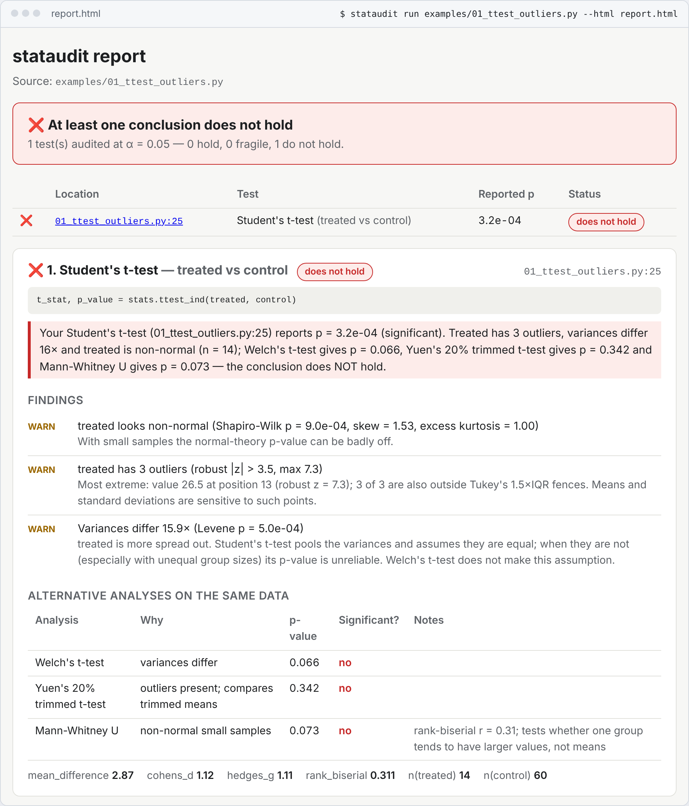

<p align="center">
  
</p>

<p align="center">
  <b>stataudit checks whether a statistical conclusion survives its own data.</b><br>
  It runs your analysis, records every test it performs, checks each test's assumptions on the data it actually received,<br>
  computes the alternatives a careful statistician would also run, and says whether the result still holds.
</p>

<p align="center">
  <a href="https://github.com/bhaskargurram-ai/stataudit/actions/workflows/ci.yml"></a>
  <a href="LICENSE"></a>
  
  
  
</p>

It doesn't matter whether a person or an AI assistant wrote the analysis. stataudit only looks at what the code did to the data.

<p align="center">
  
  <br><sub>Real output: <code>stataudit run examples/01_ttest_outliers.py --html report.html</code>, cropped below the result card. The script reported a significant difference; nothing that accounts for the three outliers agrees.</sub>
</p>

> [!NOTE]
> **Status: 1.0.0.** stataudit traces 13 `scipy.stats` tests plus statsmodels OLS, in scripts and Jupyter notebooks. It also recomputes p-values reported in text (`check-report`), lints analysis code without running it (`lint`), and runs all three on pull requests. The agent (`fix`, `explain`) is **experimental and off by default**; it needs your own LLM API key, and nothing it writes counts until stataudit has run it. The full reference for every command, option and key is [docs/REFERENCE.md](docs/REFERENCE.md).

## Contents

- [Why audit an analysis?](#why-audit-an-analysis)
- [How it works](#how-it-works)
- [Analyses that look fine](#analyses-that-look-fine)
- [Quick start](#quick-start)
- [What each auditor checks](#what-each-auditor-checks)
- [How verdicts work](#how-verdicts-work)
- [Checking reported numbers](#checking-reported-numbers-check-report)
- [Linting without running](#linting-without-running-lint)
- [Agent: fix and explain (experimental)](#agent-fix-and-explain-experimental)
- [MCP server and web UI](#mcp-server-and-web-ui)
- [GitHub integration](#github-integration)
- [Security model](#security-model)
- [How stataudit compares](#how-stataudit-compares)
- [Configuration](#configuration) · [CLI reference](#cli-reference)
- [FAQ](#faq) · [Limitations](#limitations) · [Roadmap](#roadmap)
- [Contributing](#contributing) · [License](#license)

## Why audit an analysis?

More and more statistics is done by asking an AI assistant. The code runs and a p-value comes out, but the conclusion can still be wrong, because the test's assumptions don't fit the data:

- a Pearson correlation produced by two extreme points;
- a Student t-test on small, skewed samples whose variances differ sixteenfold;
- a chi-square test on a table whose expected counts are mostly below 5;
- an OLS slope whose standard error ignores heteroskedastic residuals;
- fifteen metrics tested, three "significant", none corrected.

None of these crash, and all of them look plausible. People make the same mistakes: in a static analysis of 45 Python data-science notebooks, only 11 checked every assumption their tests rely on and only 2 applied any multiple-comparison correction ([*The Fault in our Stats*, ASE 2025](https://conf.researchr.org/details/ase-2025/ase-2025-papers/226/The-Fault-in-our-Stats)).

stataudit doesn't judge the code or the author. It asks the questions a reviewing statistician asks first:

- **What did each test actually receive?** Not the variable names: the arrays, after your filtering and cleaning.
- **Do its assumptions hold on that data?** Normality, outliers, equal variances, leverage, expected counts.
- **What do the robust alternatives say?** Welch instead of Student, Spearman instead of Pearson, Fisher instead of chi-square, HC3 standard errors, Holm across all p-values.
- **Does the conclusion survive?** If every analysis a failed check calls for lands on the other side of α, it doesn't.

A careful analysis gets ✅ and no alternatives at all. ⚠️ means **fragile**, not wrong.

## How it works

<p align="center">
  
</p>

1. **Trace.** `stataudit run` executes your script or notebook in a subprocess with a timeout. Thin wrappers around `scipy.stats` (and statsmodels OLS, when installed) record each call's input arrays, options, result and call site (`analysis.py:25`, or `analysis.ipynb cell 4, line 2` in a notebook). Your code runs unchanged and gets the real return values.
2. **Audit.** Each recorded call goes to the auditor for that test, which checks the assumptions on the recorded data. Every finding carries its evidence: Shapiro-Wilk p and skew, robust z of each outlier, variance ratio and Levene p, Cook's distance, expected counts.
3. **Alternatives.** Only when a check fails, stataudit computes the analyses that check calls for, on the same data: Welch's t when variances differ, Yuen's trimmed t and Mann-Whitney U with outliers, Spearman and a refit without high-leverage points for a correlation, HC3 standard errors for a regression, Fisher's exact or a Monte Carlo test for a sparse table, and Holm-Bonferroni across every p-value in the script.
4. **Verdict.** Fixed rules compare the conclusions at α: ✅ **holds**, ⚠️ **fragile** or ❌ **does not hold**, with one plain-English sentence per test. No LLM is involved.

Two more commands work without running anything: [`check-report`](#checking-reported-numbers-check-report) recomputes p-values from results reported in text, and [`lint`](#linting-without-running-lint) reads analysis code as a syntax tree.

## Analyses that look fine

Each bundled example is the kind of analysis an assistant writes when asked a simple question. Every verdict below is real output of `stataudit run examples/<file>`, and [`tests/test_examples.py`](tests/test_examples.py) pins them.

<p align="center">
  
</p>

| Example | What the script concluded | What stataudit found | Verdict |
|---|---|---|---|
| [`01_ttest_outliers.py`](examples/01_ttest_outliers.py)<br><sub>"Is the new onboarding flow different?"</sub> | Student's t-test, p = 3.2e-04 | treated has 3 outliers and is non-normal (n = 14); variances differ 15.9×. Welch p = 0.066, Yuen p = 0.342, Mann-Whitney p = 0.073 | ❌ does not hold |
| [`02_pearson_leverage.py`](examples/02_pearson_leverage.py)<br><sub>"Does marketing spend predict sign-ups?"</sub> | Pearson r = 0.81, p = 1.2e-06 | 2 high-leverage points (two national campaigns) create the correlation. Without them r = 0.06, p = 0.774; Spearman ρ = 0.29, p = 0.154 | ❌ does not hold |
| [`03_chisq_sparse.py`](examples/03_chisq_sparse.py)<br><sub>"Does churn reason depend on plan?"</sub> | chi-square on a 3×4 table, p = 0.03 | 8 of 12 cells (67 %) have expected count < 5, minimum 0.07. Monte Carlo permutation test (20,000 tables, fixed margins and seed): p = 0.08 | ❌ does not hold |
| [`04_many_tests.py`](examples/04_many_tests.py)<br><sub>"Which of 15 metrics changed?"</sub> | 15 Welch t-tests, 3 significant | no assumption problems, but with 15 tests the chance of at least one false positive is 54 %. After Holm, 2 of the 3 survive; one (p = 0.02) gets adjusted p = 0.256 | ⚠️ fragile |
| [`05_good_analysis.py`](examples/05_good_analysis.py) | Welch t-test, p = 0.003 | no assumption problems, so no alternatives are computed | ✅ holds |
| [`06_notebook.ipynb`](examples/06_notebook.ipynb)<br><sub>the same mistake as 01, in a notebook</sub> | Student's t-test at `cell 4, line 2`, p = 0.01 | new has 2 outliers and is non-normal (n = 12); variances differ 12.4×. Welch p = 0.136, Yuen p = 0.273, Mann-Whitney p = 0.149 | ❌ does not hold |

[`examples/reports/results.md`](examples/reports/results.md) is a write-up for `check-report`: of its 8 reported results, 5 are consistent, 1 is inconsistent and 2 are gross inconsistencies ([below](#checking-reported-numbers-check-report)).

The terminal report for example 01:

```text
$ stataudit run examples/01_ttest_outliers.py
stataudit report — examples/01_ttest_outliers.py
────────────────────────────────────────────────────────────────────────────────────────
❌ At least one conclusion does NOT hold  (1 test(s): 0 hold, 0 fragile, 1 do not hold; alpha = 0.05)

❌ [1] Student's t-test — treated vs control  (01_ttest_outliers.py:25)
    > t_stat, p_value = stats.ttest_ind(treated, control)
    Your Student's t-test (01_ttest_outliers.py:25) reports p = 3.2e-04 (significant).
    Treated has 3 outliers, variances differ 16× and treated is non-normal (n = 14);
    Welch's t-test gives p = 0.066, Yuen's 20% trimmed t-test gives p = 0.342 and
    Mann-Whitney U gives p = 0.073 — the conclusion does NOT hold.
      ! treated looks non-normal (Shapiro-Wilk p = 9.0e-04, skew = 1.53, excess kurtosis
      = 1.00)
      ! treated has 3 outliers (robust |z| > 3.5, max 7.3)
      ! Variances differ 15.9× (Levene p = 5.0e-04)
      alternatives on the same data:
        - Welch's t-test: p = 0.066 (n.s.)
        - Yuen's 20% trimmed t-test: p = 0.342 (n.s.)
        - Mann-Whitney U: p = 0.073 (n.s.)  [rank-biserial r = 0.31; tests whether one
        group tends to have larger values, not means]
      effect sizes: mean_difference = 2.87, cohens_d = 1.12, hedges_g = 1.11,
      rank_biserial = 0.311
```

## Quick start

### 1. Install

```bash
pip install stataudit                 # once 1.0.0 is published to PyPI
# or, straight from GitHub:
pip install "git+https://github.com/bhaskargurram-ai/stataudit@v1.0.0"

pip install "stataudit[web]"          # + Flask for the local web UI
pip install "stataudit[mcp]"          # + the MCP server
```

The core needs only numpy, scipy, pandas, click and jinja2 on Python 3.10 or newer. statsmodels is optional: when it is installed, its OLS fits are traced too. The agent's LLM client uses the standard library, so it adds no dependencies.

### 2. Audit a script or a notebook

```bash
stataudit run examples/01_ttest_outliers.py                # terminal report
stataudit run examples/06_notebook.ipynb                   # notebooks too
stataudit run examples/01_ttest_outliers.py --html report.html --md report.md --json report.json
stataudit run analysis.py --alpha 0.01 -- --input data.csv # args after -- go to your script
```

Exit codes: `0` when every conclusion holds, `1` when any is fragile or does not hold, `2` for usage errors. Use `--fail-on fails` to exit 1 only for ❌, or `--fail-on never` to always exit 0.

**Notebooks.** `stataudit run` executes the code cells in order, in one namespace and in the notebook's directory, like "Run all" (no Jupyter needed). IPython syntax is rewritten so that line numbers stay exact: line magics and `!shell` lines are skipped, `%%time`-style cell magics keep their body, and each change is listed as a note in the report. Findings point at `name.ipynb cell N, line M`, where N counts code cells only:

```text
$ stataudit run examples/06_notebook.ipynb
❌ [1] Student's t-test — new vs old  (06_notebook.ipynb cell 4, line 2)
    > res = stats.ttest_ind(new, old)
    ...
Script-level checks
  · 3 IPython-only line(s) were skipped or rewritten before running
    cell 1, line 1: skipped magic %matplotlib: %matplotlib inline; cell 2, line 1:
    skipped shell command: !pip install --quiet scipy; cell 4: removed the cell magic
    %%time (its Python body still runs)
```

**From Python or inside Jupyter:**

```python
import scipy.stats as stats
import stataudit

with stataudit.recording() as calls:
    stats.ttest_ind(treated, control)
    stats.pearsonr(spend, signups)

stataudit.report(calls)          # renders as Markdown in Jupyter; .to_text(), .to_html(), .to_json()
```

`recording()` also catches names imported before the block (`from scipy.stats import ttest_ind`), because it temporarily rebinds them in the calling module. You can audit data directly as well:

```python
stataudit.audit_ttest(a, b)                       # Student by default, like scipy
stataudit.audit_pearson(x, y)
stataudit.audit_chi2(table)
stataudit.audit_ols(df[["dose", "age"]], df["response"])
stataudit.audit_call("f_oneway", [g1, g2, g3])    # any supported scipy.stats test by name
stataudit.audit_script("analysis.py")             # or audit_notebook("analysis.ipynb")
stataudit.check_report_text("t(28) = 2.20, p = .36")
stataudit.lint_file("analysis.py")
```

**A CSV, no script:**

```bash
stataudit check-data data.csv --test ttest_ind --group-col group --value-col minutes
stataudit check-data data.csv --test chi2_contingency --x-col plan --y-col reason
```

### 3. Check reported results and lint code

```bash
stataudit check-report examples/reports/results.md        # also .txt, .rst, .html, and .pdf with pdftotext
stataudit lint examples/01_ttest_outliers.py examples/06_notebook.ipynb
```

### 4. Add it to pull requests

```bash
stataudit init            # add --agent to also set up the experimental fix agent
```

`init` writes the caller workflows described under [GitHub integration](#github-integration) plus a commented `stataudit.toml`, detects how to install your analyses' dependencies (`requirements.txt`, else `pip install -e .`; override with `--install-command`), refuses to overwrite existing files unless you pass `--force`, and prints the next steps.

## What each auditor checks

| Test (`scipy.stats`) | Checks on the recorded data | Alternatives computed on the same data |
|---|---|---|
| `ttest_ind` | per-group normality (Shapiro-Wilk for 3 ≤ n ≤ 5000, skew, kurtosis); outliers (robust z by MAD > 3.5, Tukey IQR); variance ratio and Levene (median) | Welch's t (if Student and variances differ), Yuen's 20 % trimmed t (outliers), Mann-Whitney U with rank-biserial r (outliers or non-normal small n); Cohen's d, Hedges' g |
| `ttest_rel` | normality and outliers of the paired differences | Wilcoxon signed-rank |
| `ttest_1samp` | normality and outliers | Wilcoxon signed-rank against `popmean` |
| `pearsonr` | outliers, normality, leverage and Cook's distance (> 4/n), deleting high-leverage points as a group, whether dropping any one point flips significance | Spearman; Pearson without the high-leverage points; Pearson without the most influential point |
| `linregress`, `stataudit.audit_ols`, statsmodels OLS | residual normality, Breusch-Pagan (Koenker), Cook's distance and leverage, leave-one-out | HC3 robust SE and p-value for each slope; refit without high-influence points |
| `f_oneway` | per-group normality and outliers, Levene | Welch's ANOVA, Kruskal-Wallis |
| `chi2_contingency` | Cochran's rule (any expected count < 1, or > 20 % of cells < 5), non-integer "counts", Yates note | Fisher's exact (2×2) or a Monte Carlo permutation p-value with fixed margins and a fixed seed (r×c) |
| `fisher_exact`, `mannwhitneyu`, `wilcoxon`, `kruskal`, `spearmanr`, `shapiro` | notes: ties, zero differences, very small n, smallest attainable p, normality pre-testing | none |
| **Whole script** | how many p-values were computed and how many are significant | Holm-Bonferroni adjusted p for every test, and which results survive |
| **Whole script** | the same arrays put through 3 or more different tests ("test shopping"); groups with n < 10 | none |

Every statistical helper (HC3, Breusch-Pagan, Welch's ANOVA, Cook's distance, Holm, Monte Carlo chi-square) is written with numpy and scipy, and the test suite checks each one against an independent calculation: direct matrix formulas, brute-force leave-one-out refits, exact hypergeometric enumeration and hand-worked examples.

## How verdicts work

| Status | When |
|---|---|
| ✅ **holds** | No assumption problem changes the conclusion. Warnings can still appear, but every recommended alternative agrees. |
| ⚠️ **fragile** | Some recommended alternatives disagree, *or* a sensitivity analysis (dropping one point, dropping the high-leverage points) changes the conclusion, *or* the result does not survive Holm-Bonferroni across the script. |
| ❌ **does not hold** | Every recommended alternative reaches the opposite conclusion at α, or there is a critical problem, such as NaNs that make the statistic NaN or a "contingency table" that isn't made of counts. |

"Recommended" alternatives are computed only when an assumption check fails: Welch's t-test runs only when the variances differ, so a clean analysis gets no alternatives at all. The overall status is the worst status among the tests, raised to fragile when the script tested the same data with three or more different tests.

## Checking reported numbers (`check-report`)

Analyses end up as prose: a report, a README, a paper draft, an assistant's summary. `stataudit check-report` reads APA-style results from Markdown, plain text, reStructuredText, HTML, or PDF (when `pdftotext` is installed), recomputes each p-value with scipy from the reported statistic and degrees of freedom, and compares it with the reported one, in the spirit of [statcheck](https://github.com/MicheleNuijten/statcheck). Nothing is executed.

```text
$ stataudit check-report examples/reports/results.md
stataudit check-report — examples/reports/results.md
────────────────────────────────────────────────────────────────────────
❌ A reported p-value flips significance
  8 result(s): 5 consistent, 1 inconsistent, 2 gross, 0 impossible; alpha = 0.05

❌ gross inconsistency  line 16: F(2, 69) = 2.95, p = .03
    Reported p = .03, but the statistic gives p = 0.059: the result is not significant at α = 0.05.
❌ gross inconsistency  line 17: z = 1.70, p < .05
    Reported p < .05, but the statistic gives p = 0.0891: the result is not significant at α = 0.05.
⚠️ inconsistent  line 18: t(35) = 2.04, p = .03
    Reported p = .03, but the statistic gives p = 0.049.
(5 consistent result(s) not shown; use -v to list them)
```

| Status | Meaning |
|---|---|
| **consistent** | The reported p-value can follow from the reported statistic, allowing for rounding: `2.20` stands for [2.195, 2.205] and `p = .036` for [.0355, .0365]. |
| **inconsistent** | It cannot, but the significance decision at α is the same. |
| **gross** | It cannot, and the decision flips: reported significant but recomputed not, or the reverse. As in statcheck, `p = .05` counts as significant at α = .05. |
| **impossible** | p outside [0, 1] or exactly 0, df ≤ 0, \|r\| > 1, negative F or χ². |

**What it reads.** `t(28) = 2.20`, `F(2, 45) = 3.81`, `r(48) = .32`, `χ2(2, N = 120) = 7.31` (also `χ²`, `chi2`, `chi-square`, `X2`), `z = 2.31` and `Q(12) = 25.1`, as well as R's output style (`t = 2.20, df = 28`, `X-squared = 7.31, df = 2`), Welch's fractional df, Markdown italics, simple LaTeX and Unicode minus signs. The p-value may be `p = .036`, `p < .001`, `ps < .01`, `p = 2.3e-5` or `ns`. "One-tailed" in the same sentence makes it check one-tailed. Near words such as "Bonferroni", "Holm" or "adjusted", it only checks that the corrected p is not smaller than the uncorrected one.

**What it doesn't.** Results split over table cells, tests without a df-based reference distribution (U, W, H) and the exact values of corrected p-values. A flag is a reason to look, not a verdict on the analysis.

Options: `--alpha`, `--fail-on inconsistent|gross|never` (default `inconsistent`), `--json`, `--md`, `--html`, `-v` to list consistent results too.

## Linting without running (`lint`)

Some analysis code can't be run in CI: the data is private, too large or behind a VPN. `stataudit lint` reads `.py` and `.ipynb` files as a syntax tree, executes nothing and needs no data, so it is fast enough for every pull request.

| Rule | Name | Severity | Fires when |
|---|---|---|---|
| SA101 | `uncorrected-multiple-tests` | warn | 3 or more hypothesis-test calls, or a test inside a loop or comprehension, and no multiple-comparison correction in the file |
| SA102 | `student-t-unchecked-variances` | warn | `ttest_ind` without `equal_var=False` (or a non-zero `trim`) and no `levene`/`bartlett`/`fligner` in the file |
| SA103 | `pearson-unchecked` | warn | `pearsonr` and no scatter plot, outlier check or rank correlation in the file |
| SA104 | `chi2-small-expected` | warn / info | `chi2_contingency` on a literal table that fails Cochran's rule (warn), or on a computed table whose expected counts are never inspected (info) |
| SA105 | `test-shopping` | warn | the same data passed to 3 or more different test functions |
| SA106 | `p-threshold-selection` | warn | `p < 0.05`-style comparisons where SA101's conditions hold |
| SA107 | `normality-pretest` | info | a normality test in an `if` chooses which hypothesis test runs |

```text
$ stataudit lint examples/04_many_tests.py
stataudit lint — examples/04_many_tests.py
────────────────────────────────────────────────────────────────────────
⚠️ 2 warning(s), 0 note(s) (1 statistical test call(s) found)

04_many_tests.py:27: SA101 uncorrected-multiple-tests [warn]
    1 test call(s), 1 inside a loop or comprehension; no multiple-comparison correction (Holm, Bonferroni, FDR) in this file.
    > res = stats.ttest_ind(variant, control, equal_var=False)
    fix: Collect the p-values and adjust them, e.g. `statsmodels.stats.multitest.multipletests(pvals, method='holm')` or `scipy.stats.false_discovery_control(pvals)`, and report the adjusted values.

04_many_tests.py:28: SA106 p-threshold-selection [warn]
    p-values are compared with a fixed threshold (res.pvalue < 0.05) across 1 uncorrected test call(s) in a loop.
    > flag = "*" if res.pvalue < 0.05 else ""
    fix: Compare adjusted p-values (Holm or Benjamini-Hochberg) with the threshold, and report effect sizes with confidence intervals rather than a significant/non-significant split.
```

Suppress a finding with a comment on the reported line, `# stataudit: ignore` or `# stataudit: ignore[SA102, SA105]`; choose rules with `--select` / `--ignore`, or `lint_ignore` in `stataudit.toml`. `--list-rules` prints every rule with its fix, `--fail-on warn|info|never` (default `warn`) sets the exit code, and `--json` / `--md` write reports. Notebooks are linted as one program. Lint findings are heuristics about code, not facts about data: `stataudit run` is the stronger check whenever you can run the analysis. The rules are in the same family as stat-lint's (see [How stataudit compares](#how-stataudit-compares)) but much simpler: they match patterns within one file and do no dataflow analysis.

## Agent: fix and explain (experimental)

Finding a fragile conclusion is half the job. The opt-in agent tries the other half, **proposing a corrected analysis**, and stataudit then checks the proposal the only way that counts: by running it. The agent is **off by default** and needs your own API key.

<p align="center">
  
</p>

```bash
export STATAUDIT_LLM_PROVIDER=anthropic       # or openai (any OpenAI-compatible endpoint)
export STATAUDIT_LLM_MODEL=<model id>         # required; there is no default model
export STATAUDIT_LLM_API_KEY=...

stataudit fix examples/01_ttest_outliers.py               # diff + before/after verdicts; changes nothing
stataudit fix examples/06_notebook.ipynb --rounds 3 --out fixed.ipynb
stataudit explain examples/01_ttest_outliers.py           # plain-language summary
stataudit explain examples/01_ttest_outliers.py --no-llm  # the deterministic summary, no model
```

**`stataudit fix FILE`** (a `.py` script or `.ipynb` notebook)

- **What the model sees.** The script (a notebook as `# %% [cell N]` sections), stataudit's findings, and **summaries** of each traced input (n, missing values, mean, standard deviation) plus the columns and dtypes of CSV files the code names. Single observed values and raw rows only with `--share-data`. Everything is wrapped in delimiters as untrusted data.
- **What it can do.** Call read-only tools (`read_script`, `show_findings`, `data_summary`) and submit one schema-validated fix. It can't write files, run code or reach the network.
- **What stataudit checks.** The fix must parse and must not **add** denylisted constructs: imports such as `os`, `subprocess`, `socket`, `shutil`, `ctypes`, `importlib`, calls such as `eval`, `exec`, `__import__`, `open(...)` for writing. Then stataudit runs it **through the tracer, in a subprocess, with a timeout (`--timeout`, default 120 s) and every secret-looking environment variable removed**, and audits it again. It is accepted only if it runs to completion, every result the original audit judged is still answered (same data, the same unchanged line, or a replacement the model named), each of those holds or improved, no new critical finding appears, and at least one result improved.
- **What you get.** A unified diff, a before/after table and the model's rationale, labelled as unverified prose. Files change only with `--apply` (overwrite) or `--out FILE`, and only for a verified fix. A rejected proposal goes back to the model with the reasons, for up to `--rounds` rounds (default 2). Exit code 0 for a verified fix or nothing to fix, 1 otherwise, 2 when no LLM is configured.

A verified fix means stataudit's audit of the new analysis is better and every original question is still answered. It doesn't mean the new analysis is the right one for your study: switching from a t-test to Mann-Whitney changes the hypothesis from means to distributions. Read the diff. Run locally, `fix` executes the model's candidate on your machine: the environment is scrubbed and the denylist blocks the obvious escape hatches, but it is **not a sandbox**, so use it on your own analyses. For pull requests from others, use the split [agent workflow](#github-integration).

**`stataudit explain SOURCE`** writes a summary of the findings for a reader who isn't a statistician. SOURCE is a JSON report from `run`, `check-report` or `lint`, an analysis (audited first) or a report document (checked first). The text is grounded: every number in it must match a number in the findings, or the whole text is rejected and the deterministic summary is printed instead. Without an LLM configured, or with `--no-llm`, you get the deterministic summary.

**Honest limits.** The agent is tested end to end with a scripted fake model; how often real models produce fixes that pass verification has **not been measured**. Problems that need a design decision (which tests form a family, whether an outlier is an error) can't be settled by rewriting code: example 04 is one. Token use is reported with every run. OpenAI's GPT-6 Luna only calls tools through Chat Completions with `STATAUDIT_LLM_REASONING_EFFORT=none`, and GPT-6 models reject `temperature` unless reasoning is off (stataudit sends none). Details are in [docs/AGENT.md](docs/AGENT.md).

## MCP server and web UI

**MCP server.** `stataudit-mcp` (or `stataudit mcp`) is a Model Context Protocol server over stdio, so an assistant that writes an analysis can audit it before reporting a result:

| Tool | What it does |
|---|---|
| `audit_script(path, alpha)` | Runs a local `.py` or `.ipynb` file under the tracer (in a subprocess, 120-second timeout, no shell) and returns the Markdown report. |
| `audit_test(test_name, data_json, alpha)` | Audits arrays passed as JSON, for example `{"a": [...], "b": [...], "options": {"equal_var": true}}`. |
| `check_report(text \| path, alpha)` | Recomputes the reported results in a piece of text or a file. Executes nothing. |
| `lint_file(path)` | Lints a `.py` or `.ipynb` file. Executes nothing. |

```json
{
  "mcpServers": {
    "stataudit": { "command": "stataudit-mcp", "args": [] }
  }
}
```

The server treats its inputs as data: it accepts only known test names and numeric arrays (up to 200,000 values), allows only a short list of scalar options, and runs only the script you name.

**Web UI.** `stataudit ui` starts a local Flask app at `http://127.0.0.1:8765`: upload a CSV, pick a test and its columns, and read the HTML report. It binds to 127.0.0.1 by default and stores nothing.

## GitHub integration

stataudit runs on pull requests as separate workflows, so that PR code and privileged tokens never share a job ([why](#security-model)). Each caller is a few lines pointing at a reusable workflow in this repository; `stataudit init` writes them for you, and [`examples/workflows/`](examples/workflows) holds exactly what `stataudit init --agent` writes (a test keeps the two in sync). Pin `@v1.0.0`, or a full commit SHA if you want to be strict, and keep `stataudit-ref` the same.

**`.github/workflows/stataudit.yml`** checks the pull request. It is unprivileged, and it is the only place PR code runs.

```yaml
name: stataudit

on:
  pull_request:
    types: [opened, synchronize, reopened]

permissions:
  contents: read

concurrency:
  group: stataudit-${{ github.event.pull_request.number }}
  cancel-in-progress: true

jobs:
  check:
    uses: bhaskargurram-ai/stataudit/.github/workflows/check.yml@v1.0.0
    with:
      stataudit-ref: v1.0.0
      python-version: "3.12"
      # Installs what the analyses import (runs PR code, unprivileged job). numpy, scipy
      # and pandas are already there.
      install-command: ''
      fail-on: never   # or "warn" / "fail" to fail the check
```

The check job runs `stataudit ci`, which

- lints the changed `.py` and `.ipynb` files that match `lint` in `stataudit.toml`;
- runs `check-report` on the changed `.md`, `.txt`, `.rst` and `.html` files that match `reports`;
- re-runs **every** analysis that matches `run`, changed or not (a data change can change a result). Nothing is executed unless you list it;
- writes the card to the job summary (so it shows up even on fork PRs) and uploads the `stataudit-result` artifact (`result.json`, `card.md`, `pr_number`, `head_sha`).

The overall status is **fail** when an analysis does not hold or a reported result is a gross inconsistency or impossible, **warn** for fragile analyses, inconsistent results and lint warnings, and **pass** otherwise. `fail-on` (default `never`) decides whether the check itself fails.

**`.github/workflows/stataudit-comment.yml`** posts the card. It is privileged and never checks out or runs PR code.

```yaml
name: stataudit comment

on:
  workflow_run:
    workflows: ["stataudit"]   # must match the `name:` of stataudit.yml
    types: [completed]

permissions: {}

jobs:
  comment:
    if: github.event.workflow_run.event == 'pull_request' && github.event.workflow_run.conclusion != 'cancelled'
    permissions:
      contents: read
      actions: read          # download the artifact of the triggering run
      pull-requests: write   # upsert the comment and the label
    uses: bhaskargurram-ai/stataudit/.github/workflows/comment.yml@v1.0.0
    with:
      stataudit-ref: v1.0.0
      labels: true
```

It validates `result.json` strictly, re-renders the card from the validated data (the uploaded `card.md` is never posted), refuses unless the result and the PR's current head are the same commit, and creates or updates one comment marked `<!-- stataudit:card -->`, plus one label: `stataudit: pass`, `stataudit: warnings` or `stataudit: problems`. The card ends with an invisible `<!-- stataudit:data {...} -->` block (escaped, size-capped, built only from validated fields) that bots can read with `stataudit.carddata.parse_card_data`.

<details>
<summary><b><code>.github/workflows/stataudit-agent.yml</code> (optional, experimental): verified fixes on the card</b></summary>

```yaml
name: stataudit agent

on:
  workflow_run:
    workflows: ["stataudit"]   # must match the `name:` of stataudit.yml
    types: [completed]

permissions: {}

jobs:
  agent:
    if: github.event.workflow_run.event == 'pull_request' && github.event.workflow_run.conclusion != 'cancelled'
    permissions:
      contents: read
      actions: read
      pull-requests: read
    uses: bhaskargurram-ai/stataudit/.github/workflows/agent.yml@v1.0.0
    with:
      stataudit-ref: v1.0.0
      llm-provider: ${{ vars.STATAUDIT_LLM_PROVIDER }}
      llm-model: ${{ vars.STATAUDIT_LLM_MODEL }}
      llm-base-url: ${{ vars.STATAUDIT_LLM_BASE_URL }}
      llm-reasoning-effort: ${{ vars.STATAUDIT_LLM_REASONING_EFFORT }}
      python-version: "3.12"
      install-command: ''
      run-for: trusted   # or "everyone" (spends API credits on any fork PR)
    secrets:
      llm-api-key: ${{ secrets.STATAUDIT_LLM_API_KEY }}

  comment:
    needs: agent
    if: needs.agent.outputs.verified == 'true'
    permissions:
      contents: read
      actions: read
      pull-requests: write
    uses: bhaskargurram-ai/stataudit/.github/workflows/comment.yml@v1.0.0
    with:
      stataudit-ref: v1.0.0
      # Trusted values: the PR number comes from the gate job (API data, no PR
      # code ran there) and the artifact from this run's verify job.
      pr-number: ${{ needs.agent.outputs.pr-number }}
      artifact-run-id: ${{ github.run_id }}
      labels: true
```

When the check finds an analysis that is fragile or does not hold, the agent workflow runs four jobs on separate VMs: **gate** decides whether to run (reads the API only); **propose** holds the key, checks the PR out as data and never installs or runs it (`stataudit agent propose`); **verify** has no secrets and runs the original and candidate analyses (`stataudit agent verify`); **comment** re-posts the card with an agent section ("Suggested fix (verified by re-running the audit)") and the diff. Set it up with a repository secret `STATAUDIT_LLM_API_KEY`, repository variables `STATAUDIT_LLM_PROVIDER` and `STATAUDIT_LLM_MODEL` (optional `STATAUDIT_LLM_BASE_URL`, `STATAUDIT_LLM_REASONING_EFFORT`), and `[agent] enabled = true` in `stataudit.toml` on the default branch. It runs only for pull requests by owners, members and collaborators or labelled `stataudit:agent`, unless you set `run-for: everyone`.

</details>

Because `workflow_run` workflows always run from the default branch, merge the workflow files there before the comment and agent workflows act on pull requests. A composite action (`uses: bhaskargurram-ai/stataudit@v1.0.0` with `command: ci | summary | comment | agent-propose | agent-verify`) is available for custom setups; see [docs/REFERENCE.md](docs/REFERENCE.md#composite-action-actionyml).

## Security model

Running PR code safely is the core problem. stataudit splits the work so that capabilities never meet in one job:

<p align="center">
  
</p>

- **Untrusted code runs only in jobs without secrets.** The check job runs on `pull_request` with `contents: read`, no secrets and `persist-credentials: false`. stataudit itself is checked out from this repository at `stataudit-ref` and installed **before** any PR code runs, and its configuration is read from the base commit. Only files you opted in with `run = [...]` are executed; `lint` and `check-report` never execute anything.
- **The LLM key never meets PR code.** The propose job checks the PR out as data and never installs or runs it. The verify job, on a separate VM, has no secrets. Candidates also pass a static denylist before they run, but the denylist is a filter, not the boundary: the boundary is that the job that runs them holds nothing worth stealing.
- **The privileged comment job never checks out or executes PR code.** It treats the artifact as hostile: it validates the PR number and the `result.json` schema, checks the PR's current head SHA, re-renders the card itself, escapes all PR-derived text, only updates a card comment written by a bot, and warns on the card when the PR changes workflows or the stataudit configuration.
- **No `pull_request_target`, no `${{ }}` expressions in `run:` scripts, no caches,** and minimal `permissions:` everywhere. [`tests/test_workflows.py`](tests/test_workflows.py) checks these invariants on every workflow.
- **Prompt injection.** The deterministic path has nothing to inject into. Code, data, reports and docstrings reach an LLM only as delimited, untrusted data; the model has no write, exec or network tools; its output is schema-validated; and nothing it writes counts until stataudit has run and re-audited it.

stataudit raises the bar; it is **not** a sandbox. A malicious PR can still tamper with its own results inside the unprivileged job, and `stataudit run` on your laptop runs the script with your permissions, like `python analysis.py` would. Read [docs/SECURITY_MODEL.md](docs/SECURITY_MODEL.md) for the full threat model.

## How stataudit compares

Different tools answer different questions. This is our best reading of each as of October 2026; corrections are welcome.

| | [statcheck](https://github.com/MicheleNuijten/statcheck)<br><sub>Nuijten & Epskamp; R and web app</sub> | stat-lint<br><sub>[*The Fault in our Stats*, ASE 2025](https://conf.researchr.org/details/ase-2025/ase-2025-papers/226/The-Fault-in-our-Stats)</sub> | [pingouin](https://pingouin-stats.org) / [statsmodels diagnostics](https://www.statsmodels.org/stable/diagnostic.html) | LLM data-analysis agents<br><sub>e.g. ChatGPT data analysis, Julius</sub> | **stataudit**<br><sub>1.0.0</sub> |
|---|---|---|---|---|---|
| Main question | Do the reported numbers agree with each other? | Does the code meet statistical best practice? | Does this data meet this assumption? | What does my data say? | **Does the conclusion survive on the data?** |
| Input | Article text (PDF, HTML, Word) | Python notebooks, statically | Arrays you pass to each function | Data and a prompt | Your script or notebook and its data; also text and code statically |
| Runs your analysis on your data | No | No | You call each function | Writes and runs its own code | **Yes, traces your own run** |
| Checks assumptions per test | No | Checks whether the code checks them | Yes, one call at a time | If asked; varies by prompt | **Yes, automatically, on the data each test received** |
| Computes alternatives, judges the conclusion | No | No | Provides the tests (Welch, robust SEs, …) | Sometimes | **Yes: holds / fragile / does not hold** |
| Recomputes reported p-values from text | **Yes**: t, F, r, χ², z, Q | No | No | No | Yes: t, F, r, χ², z, Q, also R's output style |
| Static analysis without data | No | **Yes, dataflow over its own IR (SIR)** | No | No | Yes, simpler single-file AST rules |
| Multiple comparisons | No | Flags missing correction | Provides corrections | Varies | Holm across every traced p-value |
| Uses an LLM | No | No | No | Yes, and it decides | Optional, and it never decides |
| CI / pull requests | Not built in | Research prototype | n/a | Hosted chat | GitHub workflows and a PR comment |
| Language | R (statcheck); text in any field | Python | Python | Mostly Python | Python: `scipy.stats`, statsmodels OLS |

These tools are complementary. statcheck is the established tool for checking published articles and has been validated at scale (a validity study reported accuracy of roughly 96–99.9 % depending on settings); stataudit's `check-report` borrows the idea for analysis write-ups; it has not been validated on a corpus of articles, and it doesn't read tables. stat-lint's static analysis is more thorough than `stataudit lint`, which matches patterns in one file. pingouin and statsmodels give you every diagnostic stataudit uses and more, but you have to know which to call and what to conclude. LLM agents run analyses quickly, but nothing independent checks what they concluded. stataudit's own gaps: it sees only `scipy.stats` and statsmodels OLS calls (no R, no hand-computed tests, no mixed models), it cannot know your study design, and its agent is unbenchmarked.

## Configuration

`stataudit.toml` at the repository root (or `.stataudit.toml`, or `[tool.stataudit]` in `pyproject.toml`) configures `stataudit ci`. In CI it is read from the pull request's **base** commit, so a pull request cannot weaken its own check. Unknown keys are errors. This is what `stataudit init --agent` writes:

<details open>
<summary><b><code>stataudit.toml</code></b></summary>

```toml
alpha = 0.05
fail_on = "fail"                    # never | warn | fail: when `stataudit ci` exits non-zero

# Analyses re-run under the tracer on every pull request (this EXECUTES them, in
# the unprivileged job). Opt-in: list the scripts and notebooks to run.
run = ["analysis/**/*.py"]

# Reports whose APA-style results (t(28) = 2.20, p = .036, ...) are recomputed when they change.
reports = ["reports/**/*.md"]

# lint = ["**/*.py", "**/*.ipynb"]  # statically checked when they change
# lint_ignore = ["SA107"]
# timeout = 300                     # seconds per analysis
# max_files = 50

[agent]                             # verified fixes (stataudit-agent.yml); experimental
enabled = true
# max_fixes = 3                     # analyses per pull request
# max_tool_calls = 12
# share_data = false                # never send raw data rows to the LLM unless true

# [llm]                             # the key only comes from STATAUDIT_LLM_API_KEY
# provider = "anthropic"            # or "openai" for any OpenAI-compatible endpoint
# model = ""
```

</details>

| Key | Default | |
|---|---|---|
| `alpha` | `0.05` | significance level |
| `fail_on` | `"fail"` | `never` \| `warn` \| `fail`: when `stataudit ci` exits non-zero |
| `run` | `[]` | analyses executed in CI (opt-in) |
| `reports` | `["**/*.md", "**/*.txt", "**/*.html", "**/*.htm"]` | checked with `check-report` when changed (`init` writes `["reports/**/*.md"]`) |
| `lint` | `["**/*.py", "**/*.ipynb"]` | linted when changed |
| `lint_ignore` | `[]` | rule ids to skip |
| `timeout` | `300` | seconds per executed analysis |
| `max_files` | `50` | per category per run |
| `[agent]` `enabled`, `max_fixes`, `max_tool_calls`, `share_data` | `false`, `3`, `12`, `false` | the agent workflow |
| `[llm]` `provider`, `model`, `base_url` | | fallbacks for `STATAUDIT_LLM_*`; the API key is never read from a file |

**Environment variables (agent only)**

| Variable | Purpose |
|---|---|
| `STATAUDIT_LLM_PROVIDER` | `anthropic` (Messages API) or `openai` (any OpenAI-compatible Chat Completions endpoint) |
| `STATAUDIT_LLM_API_KEY` | API key. Only read from the environment, and stripped from every subprocess. |
| `STATAUDIT_LLM_MODEL` | Model id. **Required**; there is no default. |
| `STATAUDIT_LLM_BASE_URL` | Optional endpoint (a local server needs no key) |
| `STATAUDIT_LLM_REASONING_EFFORT` | Optional, OpenAI-compatible only: sent as `reasoning_effort` (`none` for GPT-6 Luna tool calls) |

Generic names such as `LLM_API_KEY` are deliberately not read.

## CLI reference

```text
stataudit run          FILE.py|FILE.ipynb [-- ARGS...] [report options] [--timeout 300] [--show-output]
stataudit check-data   DATA.csv --test NAME [--value-col C] [--group-col C] [--x-col C] [--y-col C]
                       [--popmean M] [--welch] [--sep S] [report options]
stataudit check-report FILE... [--alpha A] [--fail-on inconsistent|gross|never] [--json F] [--md F] [--html F] [-v]
stataudit lint         FILE... [--select IDS] [--ignore IDS] [--fail-on warn|info|never] [--json F] [--md F] [-v]
                       [--list-rules]
stataudit fix          FILE [--rounds 2] [--apply] [--out F] [--json F] [--md F] [--share-data] [--timeout 120]
                       [--max-tool-calls 12] [--alpha A] [--config F]
stataudit explain      SOURCE [--out F] [--json F] [--no-llm] [--alpha A] [--config F]
stataudit init         [--repo DIR] [--agent] [--force] [--ref REF] [--install-command CMD]
stataudit ci           [--repo DIR] [--base REV] [--head REV] [--files PATH]... [--all] [--config F]
                       [--out-dir DIR] [--fail-on config|never|warn|fail] [--pr N]
stataudit summary      --json result.json [--out F]
stataudit comment      --json result.json [--pr N] [--repo owner/name] [--expect-head-sha SHA] [--labels] [--dry-run]
stataudit agent propose | agent verify      (the agent workflow's two CI steps)
stataudit ui           [--host 127.0.0.1] [--port 8765]
stataudit mcp          (same as the stataudit-mcp command)
```

| Command | What it does | Executes code? |
|---|---|---|
| `run` | runs a script or notebook under the tracer and audits every test on its actual data | yes, your analysis |
| `check-data` | runs one test on columns of a CSV and audits it | no |
| `check-report` | recomputes the p-values of APA-style results in text | no |
| `lint` | static rules over `.py` / `.ipynb` files | no |
| `fix` | experimental: an LLM proposes a corrected analysis; stataudit verifies it by re-running it | yes |
| `explain` | experimental: plain-language summary, grounded in the findings | only if SOURCE is an analysis |
| `init` | writes the caller workflows and a commented `stataudit.toml` | no |
| `ci` | checks what a pull request changed; writes `result.json` and `card.md` | yes, files under `run` |
| `summary` | renders the card into the GitHub job summary | no |
| `comment` | validates `result.json` and upserts the PR comment (privileged job) | no |
| `agent propose` / `agent verify` | the agent's two CI steps | propose: no; verify: yes |
| `ui`, `mcp` | local web UI; MCP server over stdio | `audit_script` only |

<details>
<summary><b>Report options</b> (<code>run</code>, <code>check-data</code>)</summary>

| Option | Purpose |
|---|---|
| `--alpha A` | significance level used to judge conclusions (default 0.05) |
| `--html FILE` | write a self-contained HTML report (light and dark) |
| `--md FILE` | write a Markdown report |
| `--json FILE` | write a JSON report |
| `--fail-on fragile\|fails\|never` | exit 1 when the overall status is at least this bad (default `fragile`) |
| `-q`, `--quiet` | don't print the terminal report |
| `--color/--no-color` | force or disable ANSI colours |
| `-v`, `--verbose` | show details for clean results too |

You can also run `python -m stataudit …`. Every option, the JSON formats and the card's data block are documented in [docs/REFERENCE.md](docs/REFERENCE.md).

</details>

## FAQ

<details>
<summary><b>Does ✅ mean my analysis is correct?</b></summary>

No. It means stataudit's checks found no problem that changes the conclusion. It can't know whether your observations are independent, whether you chose the hypothesis before seeing the data, or whether a variable is a confounder. It is not a substitute for a statistician.

</details>

<details>
<summary><b>Does ❌ mean the effect isn't real?</b></summary>

No. It means the data, as analysed, doesn't support the conclusion once its assumption problems are taken into account. In example 01 the right next step is to find out why three users took twice as long, not to rerun tests until one is significant.

</details>

<details>
<summary><b>Do I need an LLM?</b></summary>

No. Tracing, auditing, alternatives, verdicts, `check-report` and `lint` are deterministic. An LLM is only used by `fix` and `explain`, and neither decides a verdict: a proposed fix counts only after stataudit has run and re-audited it, and an explanation is rejected if it contains a number that isn't in the findings.

</details>

<details>
<summary><b>Does my data leave my machine?</b></summary>

Not unless you use the agent. `run`, `check-report`, `lint`, the web UI and the MCP server work locally. `fix` and `explain` send the script and the findings, including summaries of the data (n, missing values, mean, standard deviation, CSV column names and dtypes), to the LLM provider you configure. Raw values only with `--share-data`; in CI, only with `[agent] share_data = true`.

</details>

<details>
<summary><b>Why does stataudit run my script instead of reading it?</b></summary>

Because assumptions are about data, not code. `ttest_ind(a, b)` is fine or not depending on what `a` and `b` contain after your filtering. When you can't run the analysis, `stataudit lint` gives the weaker, static answer.

</details>

<details>
<summary><b>What about R, Stata or SPSS?</b></summary>

Only Python is traced today. `check-report` works on any text, whatever produced the numbers. R support is on the roadmap.

</details>

## Limitations

- stataudit audits **assumption violations and robustness** of the tests it sees. Independence, study design, the family of tests and pre-registration are questions only you can answer.
- Only calls through `scipy.stats` (plus statsmodels OLS, when installed) are traced. Tests computed by hand, in R, or through other libraries are invisible to it.
- Assumption checks have little power at small n and too much at very large n. stataudit reports evidence (skewness, variance ratios, Cook's distance) next to p-values for that reason.
- Holm-Bonferroni treats every traced p-value as one family. If your design says otherwise, read the multiplicity section with that in mind.
- Multi-dimensional calls (`axis=1` on 2-D arrays) are recorded but not audited.
- `check-report` reads sentences, not table cells, and only checks that a p-value the text calls corrected is not smaller than the uncorrected one.
- `lint` is pattern-based and single-file; it misses problems that need dataflow across files and can flag code that is fine.
- The agent is experimental and unbenchmarked. A verified fix passes stataudit's checks; it can still change the question being asked.

## Roadmap

- More tests: logistic and Poisson regression, mixed models, survival analysis (log-rank, Cox)
- R support: tracing `t.test`, `cor.test` and `lm` through an R bootstrap
- `check-report` for results in tables
- A Jupyter extension that shows verdicts under the cell that ran the test
- Post-hoc procedures (Games-Howell) and FDR control as an alternative to Holm
- Bootstrap confidence intervals for effect sizes
- A published benchmark of the fix agent on analyses with known problems

## Contributing

Contributions are welcome. See [CONTRIBUTING.md](CONTRIBUTING.md). In short: every new check needs a test showing that it flags a bad case and passes a clean one, and every new statistical helper needs a test against an independent calculation.

```bash
pip install -e ".[dev]"
python -m pytest            # or, without pytest: python -m unittest discover -s tests
```

[docs/TESTING.md](docs/TESTING.md) describes every test level, including the agent's scripted fake-LLM tests and the workflow invariant tests. Please report security issues privately through the repository's security advisory form rather than in a public issue.

## License

[MIT](LICENSE) © 2026 Bhaskar Gurram
